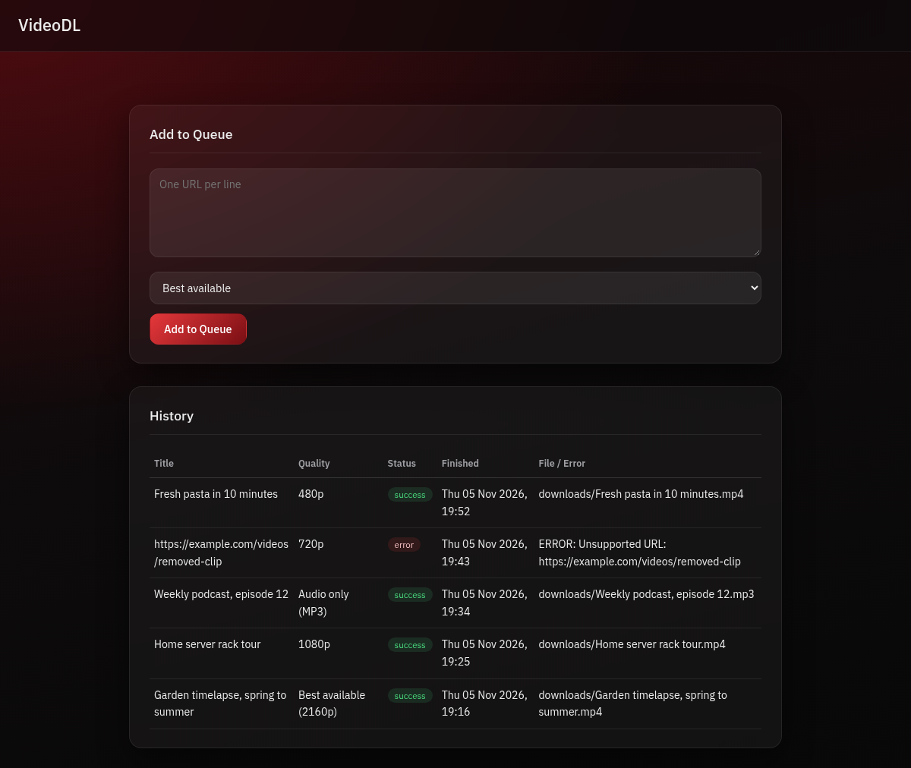

<div align="center">

# VideoDL

**A self-hosted web UI for downloading video via yt-dlp. Paste one or more URLs, pick a quality tier, and downloads run in the background with live progress and a persistent history.**

[](https://www.python.org/)
[](https://flask.palletsprojects.com/)
[](https://github.com/yt-dlp/yt-dlp)

</div>



---

## Overview

**Run it with one command: `python app.py`.** Paste one or more URLs into
the queue form, pick a quality tier, and each URL is downloaded sequentially
in the background using [yt-dlp](https://github.com/yt-dlp/yt-dlp). Progress
(percent, speed) is shown live in the Queue panel; finished downloads
(success or error) move into the History panel, backed by a local SQLite
database (`videodl.db`) so history survives restarts.

## Requirements

- Python 3.9+
- [`ffmpeg`](https://ffmpeg.org/) on your `PATH` - required by yt-dlp to
  merge video/audio streams and to extract MP3 for the audio-only tier.

## Setup

```bash
python -m venv venv
source venv/bin/activate
pip install -r requirements.txt
cp .env.example .env
python app.py
```

Then open `http://127.0.0.1:5002`.

## Configuration (`.env`)

| Key | Description |
|---|---|
| `WEB_USERNAME` / `WEB_PASSWORD` | Optional HTTP Basic Auth. Leave blank to disable (loopback-only use). |
| `BIND_HOST` | Interface to bind to. Default `127.0.0.1`. |
| `PORT` | Port to listen on. Default `5002`. |
| `ALLOW_INSECURE` | Set `true` to allow binding to a non-loopback host without auth (e.g. behind a reverse proxy that handles auth). |
| `DOWNLOAD_DIR` | Where finished files are saved. Default `./downloads`. |
| `YTDLP_AUTO_UPDATE` | `true` (default) updates yt-dlp every time VideoDL starts. |
| `SECRET_KEY` | Flask session key. Set it to any long random string so the form's CSRF token survives restarts (a random one is generated otherwise). |
| `VIDEODL_DB_PATH` | Optional override for the SQLite history file. Default `videodl.db` next to `app.py`. |
| `MAX_DOWNLOAD_MB` | Largest download allowed, in MB. A video known to be bigger is refused, and a download that grows past it is stopped and its partial file deleted. Default `4096`. |
| `MAX_VIDEO_MINUTES` | Longest video allowed, in minutes. Default `240`. |
| `MIN_FREE_MB` | Disk space to keep free in `DOWNLOAD_DIR`, in MB. A download that would go below it is refused or stopped. `0` turns the check off. Default `2048`. |

The app refuses to bind to a non-loopback host unless auth is configured or
`ALLOW_INSECURE=true` is set.

Live streams (and streams that have not started yet) are refused, since they
never finish and would hold the single download slot for good. Playlist,
channel and other links that hold several videos are refused too: paste the
link of each video you want.

Each job in the Queue has a Cancel button. A download that a restart
interrupts is tried once more; if a second restart interrupts it as well,
it is marked as failed instead of being queued again.

## Quality tiers

| Label | What it does |
|---|---|
| Best available | Highest quality video+audio yt-dlp can find |
| 1080p / 720p / 480p | Caps resolution, falls back gracefully if a site doesn't offer that height |
| Audio only (MP3) | Extracts audio and converts to MP3 via ffmpeg |

## Keeping yt-dlp updated

YouTube changes how its player works every few weeks, and old copies of
yt-dlp then fail with `HTTP Error 403: Forbidden`. Installing from GitHub
only gets the yt-dlp that was newest on the day you installed, so VideoDL
keeps it fresh itself:

- Every time VideoDL starts it runs `pip install -U "yt-dlp[default]"` and,
  if a newer version arrived, restarts itself to load it. Turn this off with
  `YTDLP_AUTO_UPDATE=false` in `.env`.
- A copy that stays running for weeks keeps the version it started with, so
  restart it now and then (in Docker, `docker restart videodl` once a week
  from cron or a systemd timer does it).
- When YouTube still answers 403, the History panel says so and points here.

To update by hand:

```bash
pip install -U "yt-dlp[default]"
```

## Tech

- Flask web UI, SQLite for job/history persistence, a single background
  worker thread processing one download at a time.
- No build step - inline templates and static assets.

## License

MIT - made by Drew
